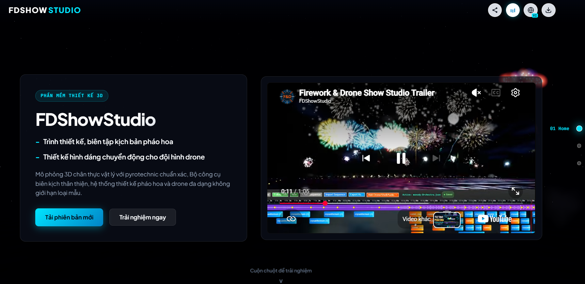
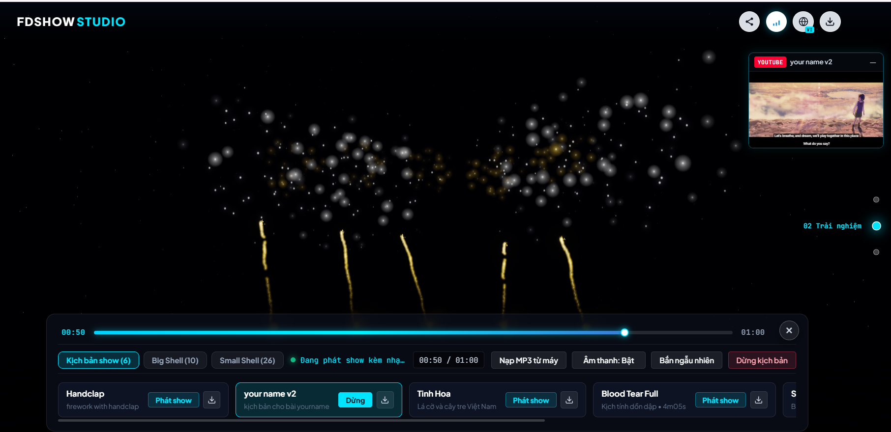

# Website FDShowStudio

  <a href="README.md">English</a> | <strong>Tiếng Việt</strong>

**Website FDShowStudio** là phiên bản web trực tuyến của hệ sinh thái **FDShowStudio**. Phiên bản này được xây dựng với mục tiêu quảng bá, giới thiệu phần mềm chính FDShowStudio, đồng thời cung cấp công cụ mô phỏng 3D tương tác giúp người dùng có thể trực tiếp trải nghiệm và thưởng thức các kịch bản trình diễn pháo hoa & drone nghệ thuật ngay trên trình duyệt mà không cần cài đặt.

---

## Các tính năng nổi bật

- **Màn hình trải nghiệm 3D sống động:** Mô phỏng các màn trình diễn pháo hoa và drone chân thực trên nền tảng Three.js với hiệu ứng ánh sáng, khói và âm thanh không gian.

- **Trình phát kịch bản JSON:** Đọc và đồng bộ mượt mà các file kịch bản định dạng `.json` được thiết kế và xuất từ phần mềm FDShowStudio.

- **Đồng bộ âm nhạc & Nhúng YouTube:** Tích hợp phát nhạc từ YouTube hoặc nạp file MP3 trực tiếp từ máy tính để đồng bộ chính xác với từng nhịp nổ của pháo hoa.
- **Lưu trữ đám mây (Netlify Blobs):** Quản lý và nạp nhanh danh mục các kịch bản show mẫu được tối ưu dung lượng băng thông.
- **Hỗ trợ đa ngôn ngữ (i18n):** Giao diện thân thiện hỗ trợ chuyển đổi linh hoạt giữa Tiếng Việt, Tiếng Anh, Tiếng Nhật và Tiếng Trung.

---

## Hệ sinh thái & Dự án liên quan

- **[FDShowStudio](https://github.com/ThaoLinn20/Shell-Drone-Editor):** Phần mềm máy tính chuyên dụng để thiết kế, biên đạo timeline và xây dựng kịch bản pháo hoa & drone show 3D chi tiết.
- **[Thư viện pháo (Firework Engine)](https://github.com/ThaoLinn20/firework-engine):** Thư viện mã nguồn lõi xử lý mô phỏng vật lý, đường bay hạt (particles) và hiệu ứng nổ pháo hoa.

---

## Công nghệ sử dụng

- **Frontend:** [Three.js](https://threejs.org/), [Vite](https://vitejs.dev/), JavaScript (ES6+), HTML5 Canvas, Web Audio API
- **Deployment & Hosting:** [Netlify](https://www.netlify.com/) (Hỗ trợ CDN toàn cầu, Security Headers & SPA Routing)

---

## Liên hệ (Contact)

- **Tác giả:** ThaoLinn20
- **Email:** [aotrame@gmail.com](mailto:aotrame@gmail.com)
- **GitHub:** [@ThaoLinn20](https://github.com/ThaoLinn20)
